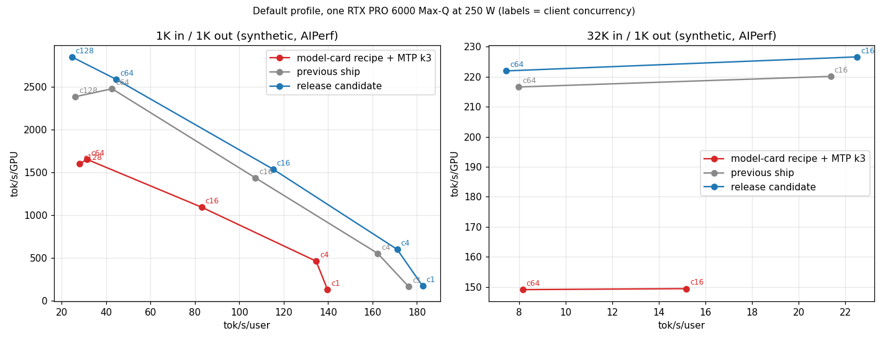

# Qwen3.8-27B-NVFP4-SingleGPU-Serving

**Qwen3.8-27B NVFP4 on a single 250 W GPU.** Serving `Qwen3.8-27B` in NVFP4 with vLLM on **one RTX PRO 6000 Blackwell Max-Q at a 250 W power limit**: a vLLM patch
series, a long-context-calibrated NVFP4 checkpoint recipe, two serving profiles, and the harness and methods used to
measure speed and accuracy.

## Results

Before = the published `nvidia/Qwen3.8-27B-NVFP4` with its model-card vLLM recipe plus MTP k=3 on stock vLLM. After =
this repo's release candidate. Same GPU, same 250 W limit, **measured in the same session**, interleaved, 2 repeats
per arm. Details, evidence levels and run counts: [docs/RESULTS.md](docs/RESULTS.md).

| | before (card recipe + MTP) | after |
|---|---|---|
| single-user decode, real prompts (tok/s/user) | 116.6 | **216.9** latency profile (+86%) / 162.3 default (+39%) |
| 1K/1K throughput, c=16 / c=64 / c=128 (tok/s/GPU) | 1,094 / 1,651 / 1,602 | **1,539 / 2,586 / 2,848** (+41% / +57% / +78%) |
| 32K/1K throughput, c=16 (tok/s/GPU) | 149 | 227 (+52%) |
| TTFT, 124K-token prompt, c=1 | 36.6 s | 19.3 s (-47%) |
| KV-cache capacity (tokens) | 1.25M | 2.01M (+61%) |
| accuracy | | final gate PASS in both profiles vs the previous build; vs the published checkpoint GPQA-D, IFBench, HLE within noise, MRCR-128K -1.1 (inside a -1.5 gate) |
| reliability | | soaks of 2 h (default profile) and 1 h (latency profile): 12,855 requests, 0 errors, no drift; cold restarts bit-exact (15/15 session pairs per profile) |

Footnote: against the card recipe **without** speculative decoding (day-1 single runs, different session), single-user
real-prompt decode was ~59 tok/s/user, so the latency profile is ~3.7x. Throughput rows are synthetic AIPerf.



What made the difference, in order of impact: speculative decoding chosen per concurrency (MTP head with a k3/k1
schedule; DFlash2 k7 below 16 concurrent requests), an int16 GDN recurrent state, a GDN spec-decode state that keeps
one page per request ("recover") with its commit folded into the next verify, a K8V4 KV cache (FP8 keys, NVFP4
values), NVFP4 GDN projections made safe for long context by 32K-token calibration, FP8 prefill attention on SM120,
and a handful of small kernels that pay only because the card is always at its power cap.

How the work was run, and what did not work: [docs/PROCESS.md](docs/PROCESS.md). Measurement rules:
[docs/METHODS.md](docs/METHODS.md).

## Quickstart

```bash
# 1. Patched vLLM image (CPU only; upstream nightly f5d93296 + patches/)
bash harness/serve/build_image.sh qw38/vllm:f5d93296-qw38

# 2. Weights: download the checkpoint (or build it with recipes/quantize_a2gdn_lc32k.sh from Qwen/Qwen3.8-27B),
#    verify it, and download the DFlash2 drafter (latency profile) at its pinned revision
hf download frida404/Qwen3.8-27B-NVFP4-LC32K --local-dir models/a2gdn-lc32k-mtpa4
(cd models/a2gdn-lc32k-mtpa4 && sha256sum -c ../../recipes/SHA256SUMS)
hf download maurienne-ai/Qwen3.8-27B-DFlash2-NVFP4-RTNcal --revision bd7a934213c47a9e7ef69eef36bb3325f47fd1f1 \
  --local-dir models/dflash2-nvfp4

# 3. Serve (default profile for throughput; latency profile for <= 16 concurrent requests). serve.sh boots with the
#    shipped FlashInfer/Triton tuning data (harness/serve/tuning, RTX PRO 6000 Max-Q): see the note below.
sudo nvidia-smi -i 0 -pl 250     # optional: reproduce the measured power limit
PROFILE=default GPU=0 PORT=8000 MODEL_DIR=$PWD/models/a2gdn-lc32k-mtpa4 bash harness/serve/serve.sh
PROFILE=latency GPU=0 PORT=8000 MODEL_DIR=$PWD/models/a2gdn-lc32k-mtpa4 DRAFTER_DIR=$PWD/models/dflash2-nvfp4 bash harness/serve/serve.sh

# 4. Measure (client venv: Python >= 3.11, aiperf 0.13.0 does not install on 3.10; uv fetches 3.12 if needed;
#    no uv yet? `curl -LsSf https://astral.sh/uv/install.sh | sh` or `pip install uv`, see docs.astral.sh/uv)
uv venv --python 3.12 .venv-client && . .venv-client/bin/activate && uv pip install -r harness/requirements-client.txt
MODEL=$PWD/models/a2gdn-lc32k-mtpa4 bash harness/perf/sweep_aiperf.sh 8000 1024 1024 results/1k1k "1 16 64 128"
```

**Tuning data is required, not only for reproducibility.** Without a FlashInfer tactic store that matches the GPU and
the image, the first boot autotunes during warmup and the tuner's memory is counted as activations by vLLM's KV sizing:
on the RTX PRO 6000 Max-Q (96 GB) the default profile comes up with ~24% less KV cache and the latency profile fails to boot ("No available memory for
the cache blocks"). `serve.sh` passes the store in `harness/serve/tuning/` (tuned on the RTX PRO 6000 Blackwell Max-Q
at 250 W with this image) unless `FI_TACTICS=none`; on other GPUs, see that directory's README and
[docs/FINAL_CONFIG.md](docs/FINAL_CONFIG.md) section 3.

Docker notes: the container runs as root and bind-mounts `MODEL_DIR` (and `DRAFTER_DIR`). On root-squashed NFS, keep
the checkpoint world-readable with real files (no symlinks pointing outside the directory) or copy it to a local disk,
or try `AS_USER=1`; the header of `harness/serve/serve.sh` lists all hooks (`NAME`, `DOCKER_ARGS`, `COMPILE_CACHE`,
`SAVE_TACTICS`, ...).

The published `nvidia/Qwen3.8-27B-NVFP4` checkpoint (BF16 MTP head) also loads as `MODEL_DIR`; earlier builds of
this stack were gated on it, but the release-candidate profiles were measured on `a2gdn-lc32k-mtpa4` only.

## Layout

```
patches/    46 vLLM patches in 13 feature groups (patches/README.md), against vLLM f5d93296
recipes/    ModelOpt PTQ recipe + long-context calibration-set builder + decontamination for a2gdn-lc32k-mtpa4
harness/    serve (docker), perf (AIPerf, real prompts, agentic replay, mixload), accuracy (NeMo Gym)
docs/       FINAL_CONFIG, RESULTS, METHODS, PROCESS
```

## Requirements

An NVIDIA Blackwell GPU (developed on SM120 RTX PRO 6000 Max-Q; accuracy runs on SM103 GB300), the vLLM nightly image
above (CUDA 13), Docker with the NVIDIA container toolkit. GB300 / arm64: the accuracy runs used the arm64 image of the
same nightly under Slurm (digest and notes in `harness/serve/build_image.sh` and docs/FINAL_CONFIG.md); `serve.sh` is
docker-only. Other GPUs are untested (docs/FINAL_CONFIG.md, "Known limits"). Building the checkpoint takes two PTQ passes on a
large-memory GPU (measured on one GB300, 288 GB: ~3.5 h for the lm_head donor, 81 min for the long-context pass).
Client-side Python packages for the harness: `harness/requirements-client.txt` (Python >= 3.11; measured with 3.12).

## License

Apache-2.0 (LICENSE, NOTICE). The patches modify vLLM (Apache-2.0). Models, drafters, datasets and benchmarks keep
their own licenses; none are included here.
