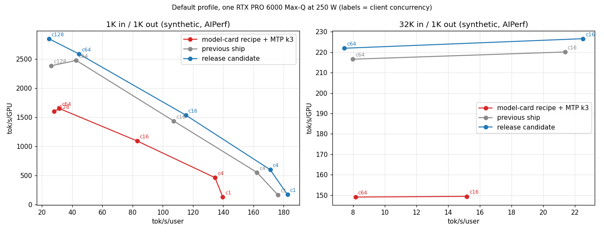
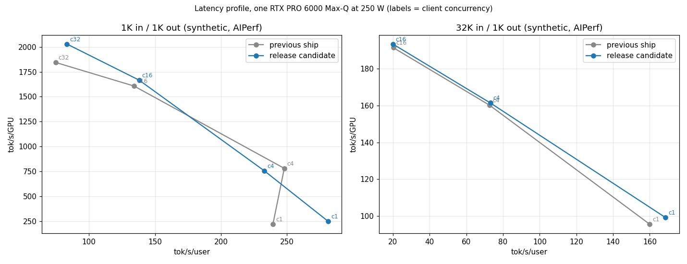

# Results (Qwen3.8-27B-NVFP4-SingleGPU-Serving)

Target: `Qwen3.8-27B` in NVFP4 served by vLLM on **one RTX PRO 6000 Blackwell Max-Q (96 GB, SM120) at a 250 W board
limit**. Accuracy gates ran on GB300 (SM103) with NeMo Gym. Work dates 2026-11-12 to 2026-11-16 (final verification).

Evidence tags (every row carries one):
- **[VERIFIED]** measured and repeated: perf A B B A with >= 2 repeats per arm and separated repeat ranges, or an
  accuracy gate with the run counts in METHODS.md;
- **[INDICATIVE]** measured but partial: a single run, another GPU or config, or within noise;
- **[HYPOTHESIS]** model or roofline estimate, not measured.

"Separated" means every repeat of one arm is outside the range of the other arm's repeats.
Perf numbers are from the RTX PRO 6000 unless marked GB300.

## 1. Headline: before / after

**Before** = the model card's vLLM recipe on the published `nvidia/Qwen3.8-27B-NVFP4` checkpoint with MTP k=3
(stock vLLM f5d93296, FP8 KV, fp32 GDN state, max-num-batched-tokens 32768). **After** = the release candidate
(docs/FINAL_CONFIG.md). Both were measured **in the same session on the same GPU**, as arm C and arm B of the
default-profile queue A B C C B A (A = previous ship, B = release candidate, C = model card + MTP; section 2.2):
un-profiled, every cell at the 250 W cap, B and C with 2 repeats each. A has 1 repeat because its second repeat (the
final A) was dropped to save wall time. Arm C ran at `--max-model-len 262144` (the others at 131072); on this GPU
131072 vs 262144 is within noise for the card recipe (c=1 61 vs 62 tok/s, c=128 1,790 vs 1,731; single runs).
[VERIFIED]

| metric (RTX PRO 6000 Max-Q, 250 W) | before: card recipe + MTP k3 | after: default profile | change |
|---|---|---|---|
| 1K/1K synthetic, c=1: tok/s/user / tok/s/GPU | 139.7 / 132 | **182.6 / 174** | +31% / +32% |
| 1K/1K synthetic, c=16, tok/s/GPU | 1,094 | **1,539** | +41% |
| 1K/1K synthetic, c=64, tok/s/GPU | 1,651 | **2,586** | +57% |
| 1K/1K synthetic, c=128, tok/s/GPU | 1,602 | **2,848** | **+78%** |
| 8K/1K synthetic, c=16 / c=64, tok/s/GPU | 506 / 601 | 698 / 851 | +38% / +42% |
| 32K/1K synthetic, c=16, tok/s/GPU | 149 | **227** | +52% |
| 124K/1K, c=1: TTFT p50 | 36.6 s | **19.3 s** | -47% |
| real prompts, c=1, tok/s/user | 116.6 | 162.3 | +39% |
| real prompts, c=1, tok/s/user, **latency profile** | 116.6 | **216.9** | **+86%** |
| agentic replay (OpenHands, ieos), c=4, tok/s/user | 92.7 | 133.8 | +44% |
| KV-cache capacity, tokens | 1,248,784 | 2,006,295 | +61% |
| 1K/1K c=128 preemptions | 96-106 | 0 | |
| weights on disk | 21.92 GB | 18.96 GB (incl. the 0.31 GB NVFP4 MTP shard) | -13.5% |
| accuracy | | final GB300 gate PASS in both profiles (section 3.2) | |

Footnote, the original baseline (no speculative decoding): the model-card recipe without MTP measured on day 1 gave
58.5-59.8 tok/s/user on real prompts at c=1 and 1,475 / 1,731 tok/s/GPU at 1K/1K c=64 / c=128 (single runs, different
session) [INDICATIVE]. Against that, the latency profile's 216.9 is ~3.7x and the default profile's 2,848 at c=128 is +65%.

Latency profile, synthetic 1K/1K tok/s/user at c=1/4/16/32: 281.2 / 232.7 / 138.0 / 83.3 (tok/s/GPU 247 / 756 / 1,666 /
2,029). The c=1/4 synthetic cells are dominated by acceptance length on AIPerf's synthetic text (Shakespeare excerpts the model recites, so drafts are easy to accept) (AL 4.1-5.0 per repeat);
use the real-prompt numbers for the low-concurrency claim. There is no separate card-recipe arm for the latency
profile; its "before" is the card recipe + MTP above.

## 2. Throughput and latency by step (RTX PRO 6000, 250 W)

### 2.1 Stack built up step by step (each line is an A/B against the line before it)

| step | change | result | evidence |
|---|---|---|---|
| int16 GDN recurrent state | `--mamba-ssm-cache-dtype int16 --block-size 1600` | 1K/1K no-spec c=64 +18%, c=128 +23%, c=256 +46% (peak 1,810 -> 2,382 tok/s/GPU); GDN kernel ~1.9x per layer | INDICATIVE (single runs); kernel VERIFIED |
| MTP head in NVFP4 + vLLM loader fix | a4 head | c=1 +6.8% tok/s/user, c=16 +6.5%; AL unchanged (2.49 vs 2.47) | INDICATIVE |
| MTP concurrency schedule, probabilistic drafts | k3 at <= 32 running, k1 above | c=64 2,152 -> 2,299 tok/s/GPU (vs fixed MTP3 1,871, no-spec 1,730); probabilistic drafts +13% / +15% / +8% at c=1/16/64 | VERIFIED (n=2-3) |
| SM120 FP8 prefill (FlashInfer cute-dsl FMHA) | default on | TTFT 32K -19%, 127K -44%; agentic TTFT p50 -35%; decode neutral | VERIFIED |
| a2gdn-lc32k weights (NVFP4 GDN projections, long calibration) | checkpoint | real prompts tok/s/GPU +8.8 / +8.4 / +12.1% at c=1/4/16, AL unchanged | VERIFIED (A/B/A n=4/3) |
| K8V4 KV cache (FP8 K + NVFP4 V) | `VLLM_KV_K8V4=1` | KV tokens 1.28-1.30x; neutral at c=16; 1K c=64 +10.8% (preemptions 26-30 -> 0); 8K c=64 +5.3%, TTFT p50 -69% | VERIFIED |
| max-num-batched-tokens 8192 | flag | 1K c=64 +10.6%; KV blocks +21.5%; 32K TTFT -11.6% (higher SM clock under the cap) | VERIFIED |
| default profile = the three above vs the previous ship | | 1K c=64 +11.7%, 8K c=64 +10.1%, 32K c=16 +11.4%, 32K c=64 +9.2%; c=1 flat | VERIFIED (A B A B A B A, 3 reps) |
| latency profile: DFlash2-NVFP4 k7 + recover | vs default MTP profile (both earlier builds: before fold / verify v2, DFlash2 with the prefill-graph cap 512) | real prompts c=1 +37.8% (217 vs 158 tok/s/user), c=4 +27.5%, c=16 +11.1%, c=32 -7.2%; crossover c=16-32, so the profile is capped at 16 concurrent. (The first, n=2 head-to-head before the cap-512 fix gave +38.7% at c=1; PROCESS.md.) | VERIFIED |
| KV grouping fix | default on | latency-profile KV +10.6% at equal speed | VERIFIED |
| D2 commit-kernel alignment hint | latency profile | c=16 +4.5%, c=32 +6.3%; bit-exact on SM120 and SM103 | VERIFIED |
| host-gap fix | latency profile | decode tok/s neutral under the cap; c=16 TTFT p50 -31 to -40% | VERIFIED |
| small-M GEMM for GDN in_proj_ba | default profile | c=1 +3.5% (154.5 -> 159.8 tok/s/user); bit-identical output | VERIFIED |
| recover + deferred-commit fold ("D3") | default profile | 1K c=16 +6.8%, c=64 +4.3%, c=128 +18.4% (preemptions 76 -> 0, TTFT p50 4.41 -> 0.75 s); J/token -2 to -16% | VERIFIED |
| fold in the latency profile | | c=16 +6.2%, c=32 +9.3% (fold + D2 vs ship) | VERIFIED |
| GDN verify v2 (split-tf32 UT/WY) on the fold path | latency profile | c=16 +1.9%, c=32 +2.0% user tok/s over fold | VERIFIED (n=2) |

### 2.2 Release candidate vs the previous ship (final same-session A/B, all cells at the 250 W cap) [VERIFIED]

Previous ship = the previously shipped build (K8V4, MNBT 8192, MTP schedule; latency: DFlash2 + recover + cap 512).
Default profile: one queue A B C C B A with A = previous ship (n=1: the final A was dropped to save wall time, so deltas
under ~2% vs A are not resolved), B = release candidate (n=2), C = model card + MTP at max-model-len 262144 (n=2; the
section 1 "before"). Latency profile: A B B A (n=2 each).

Default profile, tok/s/GPU unless noted:

| cell | previous ship | release candidate | change |
|---|---|---|---|
| 1K/1K c=1 / c=4 | 168 / 556 | 174 / 602 | +4.0% / +8.4% |
| 1K/1K c=16 / c=64 | 1,438 / 2,476 | 1,539 / 2,586 | +7.0% / +4.4% |
| 1K/1K c=128 | 2,383 | 2,848 | **+19.5%** (preemptions 79 -> 0) |
| 8K/1K c=16 / c=64 | 670 / 829 | 698 / 851 | +4.2% / +2.6% |
| 32K/1K c=16 / c=64 | 220 / 217 | 227 / 222 | +3.0% / +2.5% |
| 124K/1K c=1 / c=4 | 37.1 / 44.8 | 38.1 / 45.7 | +2.7% / +2.0% |
| real prompts c=1, tok/s/user | 153.3 | 162.3 | +5.9% |
| real prompts c=4, tok/s/GPU | 495 | 521 | +5.3% |
| agentic c=4 / c=16, tok/s/GPU | 252 / 418 | 257 / 428 | +1.8% / +2.4% |
| mixload: background 1K c=32 tok/s; 32K probe TTFT | 1,873; 3.97 s | 2,011; 3.90 s | +7.4% |
| KV tokens | 1,879,599 | 2,006,295 | +6.7% |

Per-user tok/s at 1K c=128, 32K c=64 and 124K c=4 is 5-7% lower than the previous ship because more requests run at
once (no preemptions) and TTFT is lower; tok/s/GPU is higher in every cell.

Latency profile, real prompts:

| c | previous ship, tok/s/user | release candidate | change (user / GPU) | TTFT p50 |
|---|---|---|---|---|
| 1 | 207.4 | **216.9** | +4.6% / +4.6% | 0.11 s |
| 4 | 182.4 | 193.1 | +5.9% / +2.7% | 0.14 s |
| 16 | 113.3 | 123.9 | +9.3% / +8.5% | 0.16 s |
| 32 | 69.1 | 77.2 | +11.7% / +10.3% | 0.61 s (1.03 s before) |

Agentic replay is flat (-3.4% at c=1 within acceptance-length noise, +1.1% at c=4, -0.8% at c=16). 32K/1K c=1 TTFT
4.25 s, +5.4% tok/s/user. J/token -2 to -10% in the real-prompt cells. The development A/Bs of each piece (fold, verify
v2, host gap, small GEMM) summed to within about 1 point of these totals.

### 2.3 Where the step time goes (nsys, steady decode)

| profile, cell | step | GEMMs | GDN state kernels | attention | drafter | host gap |
|---|---|---|---|---|---|---|
| latency, c=1 | 17.4 ms | 9.7 ms (56%) | 0.7 ms | | 2.0-3.0 ms | 1.7-2.2 ms |
| latency, c=16 | 30.6 ms | 13.8 ms (45%) | 6.0 ms (20%) | | | |
| default, 1K c=64 | 34.5 ms | 15.5 ms | 10.6 ms (30%) | | | |
| default, 32K c=16 | 41.9 ms | 15.0 ms | | 18.2 ms (43%, K8V4 decode) | 5.2 ms | |

At c=1 the step is weight-bandwidth bound (~11.4 ms of GEMMs, near the bytes / bandwidth floor). [VERIFIED]

## 3. Accuracy (GB300, NeMo Gym, model-card sampling T=1.0, top_p 0.95, 65,536 max output tokens)

### 3.1 Baselines on our harness (published NVFP4 checkpoint, no speculative decoding)

| benchmark | ours | model card | evidence |
|---|---|---|---|
| GPQA-Diamond | 88.21 (5 runs x 4 repeats) | 88.01 | VERIFIED |
| IFBench (stripped / raw) | 80.81 / 74.81 (8 repeats) | 78.93 | VERIFIED |
| MRCR-128K (1,492 conversations <= 128K, Qwen tokenizer) | 94.01 (4-run pool, run SD 0.34) | | VERIFIED |
| HLE (hle_verified, self-judged) | 40.86 / 42.06 (2 runs) | | VERIFIED |
| MRCR >128K slice (139 tasks, 136-196K tokens) | 85.84 (x3) | | INDICATIVE |
| BF16 control, GPQA-D | 88.38 vs NVFP4 88.51 (paired same copy) | 88.92 vs 88.01 | VERIFIED |

### 3.2 Gates for the shipped components (delta vs the matched baseline, +- 1 SE)

| component | GPQA-D x4 | IFBench x2 | MRCR-128K | other | verdict |
|---|---|---|---|---|---|
| int16 GDN state | 0.00 +- 0.93 | +0.2 / +0.5 | +0.33 +- 0.51 | | PASS [VERIFIED] |
| bf16 GDN state (rejected) | **-3.66 +- 1.23** | n.s. | | truncation 3.2 -> 8.5%, output +14% | FAIL [VERIFIED] |
| MTP spec decode (k=3) | -0.78 +- 0.45 | -1.1 | | AL 2.64-2.72 | PASS [VERIFIED] |
| recover spec state (int16) | +0.05 vs pool | 81.92 / 75.58 | -0.12 +- 0.48 | | PASS [VERIFIED] |
| MTP schedule + probabilistic drafts | +0.55 +- 0.79 | +0.12 +- 1.27 | -0.19 +- 0.49 | | PASS [INDICATIVE] |
| a2gdn-lc32k weights (vs published) | -0.33 +- 0.67 | +1.9 / +1.7 | **-1.10 +- 0.50** (2 runs) | HLE -0.84 +- 0.92 | PASS, real but in-gate MRCR cost [VERIFIED] |
| K8V4 KV cache | -0.21 +- 0.61 (x8) | +0.21 +- 1.14 | -0.56 | | PASS [VERIFIED] |
| default profile (a2gdn + MTP sched + K8V4 + MNBT 8192) vs previous ship | +0.38 +- 0.94 | | -0.16 +- 0.48 | HLE +1.19 +- 1.01; >128K +0.22 +- 1.53 | PASS [INDICATIVE] |
| latency profile, DFlash2 + recover (prefill graph cap 512) | +0.51 +- 1.01 | | -0.94 +- 0.51 | HLE +0.38 +- 1.04 | PASS [VERIFIED] |
| fold + D2 (latency) | -0.13 +- 1.05 | | -0.75 +- 0.49 | HLE +0.44 | PASS [VERIFIED] |
| D3 (default + recover + fold) | +0.25 vs K8V4 | | +0.05 | >128K -0.51 +- 0.77 (6 jobs per arm, interleaved); HLE -0.62 +- 0.75 (2 per arm) | PASS [VERIFIED] |
| verify v2 (latency) | -0.88 +- 0.87 | | +0.09 (3 jobs/arm) | >128K +1.48 +- 1.06; HLE +0.12 | PASS [VERIFIED] |
| format-disaggregated NVFP4 decode (not shipped: -8 to -45% speed) | +0.13 | +0.96 | +0.36 | | PASS, not shipped [VERIFIED] |

**Final confirmation gate of the release candidate: PASS in both profiles. [VERIFIED]** Release candidate minus the
previous ship of the same profile (base pooled with earlier jobs of the identical base config where available), on
GB300, 3 jobs per arm for MRCR and HLE, 1 for GPQA and IFBench. +- run-level SE / rollout-level SE ("-" = single job). A
benchmark fails only if its delta is clearly negative (beyond ~2 SE, or below -1 GPQA / -1.5 MRCR); none does.

| benchmark | default profile | latency profile |
|---|---|---|
| MRCR-128K x2 | +0.10 (0.23 / 0.26) | +0.13 (0.19 / 0.24) |
| MRCR >128K slice x3 | +0.31 (0.83 / 0.87) | +0.28 (0.86 / 0.83) |
| GPQA-D x4 | +0.55 (0.73 / 0.71) | -0.13 (0.87 / 0.66) |
| HLE (hle_verified) | +1.21 (0.69 / 0.57) | -0.67 (0.46 / 0.58) |
| IFBench x2, raw (stripped) | +0.83 (0.25 / 1.00) (stripped +0.92) | -0.50 (- / 1.34) (stripped -1.67) |
| verdict | **PASS** | **PASS** (watch: HLE -0.67, t ~ -1.5, EOS-in-think 123 vs 99 of 4,800; IFBench stripped -1.67 is one run, inside the +-2.4 single-run spread) |

Absolute release-candidate scores: default MRCR-128K 92.98, >128K 84.00, GPQA 88.51, HLE 40.98, IFBench 75.08 / 81.42;
latency 92.98, 84.40, 87.75, 39.90, 75.25 / 81.25. Truncation and output
length are flat in every benchmark; every job had 0 failed rollouts and the feature proof line on all 4 servers.

### 3.3 Quality and reliability checks

- **Losslessness of speculative decoding:** every drafter / sampling arm (DFlash2 and MTP; greedy and probabilistic)
  matches the target distribution given its logits: unit test at sampling-noise TV (|z| <= 1.8), and served per-token
  calibration over ~240K-480K tokens per arm (top-1 bias < 0.15%, surprisal < 0.003 nats/token). [VERIFIED]
- **Greedy determinism:** no-spec greedy output is identical run to run and across GPUs (50/50). With spec decoding,
  greedy output depends only on the target's verify width (MTP k=7 and DFlash2 k=7 are byte-identical on 50/50).
  With prefix caching on, a request resumed from a cached 1,600-token block can change greedy output (17/96 replay
  pairs; identical with and without spec decoding): chunked-prefill split numerics, not a correctness bug. [VERIFIED]
- **Bit-exactness of kernel changes:** D2, small-GEMM, host-gap and the fold (vs its eager reference) are bit-exact in
  unit gates and in long-context engine replays (175K-227K-token prompts, with and without preemption, on SM120 and
  SM103). Cross-build comparisons need pinned autotune (METHODS.md). [VERIFIED]
- **Premature EOS inside `<think>` and truncation** are tracked on every gate; no shipped component raises them
  beyond run-to-run range. Spec decoding does not change the raw EOS hazard (equal across 6 arms at 8K and 32K
  context). [INDICATIVE]
- **Stability:** a 634 s c=64 control ran 1,408/1,408 requests with 0 errors; agentic replays (124 turns) had 0
  errors; an earlier "unspecified launch failure" was a profiler multi-session artifact and did not reproduce. 
- **Soak (release candidate) [VERIFIED]:** default profile 2.03 h (1K/1K c=128 and 32K/1K c=32 loops together, KV pool
  full by design): 6,912 requests, 0 errors, no throughput drift (last vs first 15-min window -0.3%), GPU memory
  constant after warm-up, engine RSS +21 MiB/h. Latency profile 1.00 h (real prompts c=8 + agentic c=8): 5,943 requests,
  0 errors, throughput CV 0.9%, 0 preemptions. 0 tracebacks, CUDA errors or NaNs in either.
- **Restart determinism [VERIFIED]:** 3 cold restarts per profile (fresh container, fresh caches, Triton autotune seeded
  with the 6 pinned FLA-prefill picks, a fresh copy of a pinned FlashInfer tactic store), 2 greedy 20-prompt sessions
  each: all 15 session pairs token- and logprob-identical (|dlogprob| 0) in both profiles; 0 tactics re-tuned at boot.
  With the earlier, smaller tactic store, the NVFP4 GEMM shapes of this checkpoint re-tune at every boot, which is the
  likely source of the "startup session modes" in METHODS.md [INDICATIVE attribution].
- **Public patch series smoke test [VERIFIED]:** the 46-patch series applied to f5d93296 boots both profiles on the
  RTX PRO 6000 and is bit-identical to the measured release build at concurrency 1 (default: 2 sessions per arm,
  20/20 tokens and logprobs exact; latency: 1 session vs 2 independent cold restarts of the release build, 20/20 exact),
  same KV capacity. So the two upstream PRs left out of the series and the comment scrub are inert for the shipped
  profiles. Not run on GB300 or under load.
- **Incident (found and fixed): DFlash2 + recover failed MRCR by ~-10 points on GB300 only.** Root cause class:
  piecewise CUDA graphs captured for large (up to 8,192-token) padded mixed prefill + spec batches, which SM100
  captures and SM120 does not. Fix: pin `max_prefill_cudagraph_capture_tokens` to 512 (MRCR -0.31 to -0.94 after the
  fix). The exact mechanism inside those graphs is still open. [VERIFIED fix]
- **Retracted claim:** a "-2.9 point >128K loss" for the latency profile and a "-4.8" for D3 came from single-run
  baselines; repeating identical configurations moved the score by ~3 points. With 6 interleaved jobs per arm there
  is no loss (-0.51 +- 0.77). See METHODS.md.

## 4. Approaches that did not ship

| approach | result | evidence |
|---|---|---|
| bf16 GDN state | +13-19% GB300 throughput but GPQA -3.66, output +14% (state drift) | VERIFIED |
| int8 GDN state (RTN / stochastic rounding / position-keyed dither) | best +1.3% e2e at c=64 (kernel -15-20%, but the 250 W cap lowers the clock); accuracy borderline | VERIFIED null |
| uniform NVFP4 KV cache | +78% KV tokens, speed-neutral, but MRCR-128K -2.32 and >128K -3.9 (key rounding) | VERIFIED |
| per-layer mixed FP8/NVFP4 KV maps | 5.4-bit borderline (MRCR -1.17, empties 2x), 6.0-bit fails | VERIFIED |
| NVFP4 on all attention + GDN projections (a2-lh, 2K calibration) | -14% bytes, +13-35% speed, GPQA pass, MRCR-128K -2.37 | VERIFIED |
| 6 NVFP4 attention layers on top of a2gdn ("attn6") | MRCR pass, HLE -1.69 vs a2gdn, decode +1-3%: not adopted | INDICATIVE |
| QAD (logit distillation) on a2gdn | KD with top-4096 logits pushed P(END) mid-think up 85-780x (MRCR -4.5 to -8.3); fixed loss, light QAD then gave no gain (+0.18) | VERIFIED |
| EAGLE-4 drafter (evaluation license only) | AL +12% over DFlash2 at c=1, but verify cost and license: not pursued | INDICATIVE |
| model-free drafting (suffix / n-gram / hybrid) | 0.62-0.80x of MTP on agentic traffic | INDICATIVE |
| larger k3 band / k2 band in the MTP schedule | AL up 25-36% but each step +25-43% at the cap: flat or negative | VERIFIED |
| DFlash2 draft length k < 7 / per-batch k schedule | smaller k loses at c <= 16; schedule only helps at c > 20 (outside the profile) | VERIFIED |
| K8V4 decode-kernel tuning (stage-1 v2) | kernel -14.5% time, J/call only -6%, e2e neutral at the 250 W cap | VERIFIED |
| format-disaggregated NVFP4 (decode W4A16) | accuracy +0.1-1.0, speed -8 / -14 / -45% at c=1/4/16 (untuned GEMMs) | VERIFIED accuracy, INDICATIVE perf |
| CuTe DSL port of the commit kernel | bit-identical, 3% slower than Triton | VERIFIED |
| FlashInfer fused GDN decode, lm_head autotune, sampler fast path, NGC recipe knobs, attention backends | no gain on SM120 or a numerics change | INDICATIVE |
| reasoning effort low/medium; output caps | -65% tokens but GPQA -6 to -7, IFBench -16 to -21 | VERIFIED |

## 5. Explored, not shipped: third-party fine-tunes

Numbers only; no weights or derivatives are distributed.

**Swift-Qwen3.8-27B (UkisAI; a rank-32 LoRA merged into the MLP and full-attention layers; all GDN weights identical to
the base).** Its license restricts commercial use, so it was evaluated only.

| benchmark | Swift BF16 | base | delta | output tokens |
|---|---|---|---|---|
| GPQA-D x4 | 87.63 | 88.38 (BF16) | -0.76 +- 0.98 | -37% |
| IFBench (stripped) x2 | 79.25 | 80.81 (NVFP4) | -1.6 (quant-confounded) | -38% |
| MRCR-128K | 95.00 | 95.33 (BF16) | -0.33 +- 0.54 | -16% |

- Its NVFP4 PTQ with the published recipe keeps long context (MRCR-128K +0.27 vs the base NVFP4 pool; quantization
  cost -0.70 vs the base's own ~-1.3), GPQA passes (-0.45), HLE +1.59, but **IFBench raw -3.23 fails** and
  is a fine-tune trait (BF16 was already -2.8). [INDICATIVE]
- The IFBench loss is not a short-thinking trade-off: per-prompt deficit is uncorrelated with thinking length
  (r = 0.07), and pass@4 recovers 7 of 10 lost prompts.
- A light MLP-only QAD / self-distillation attempt (50 steps) left IFBench -2.90 +- 0.97 vs base: closed as a miss.
- Reading: a better accuracy-per-token point on GPQA than lowering reasoning effort (~+3 above the effort curve at
  -37% tokens), but not a gate-passing replacement because of IFBench.

**EfficientThink community fine-tune:** -14 to -33% output tokens; GPQA -1.1, IFBench -2.6 to -6.1,
MRCR-128K -1.7 (BF16) and -4.8 with its own NVFP4 export. Its full-rank update touched the GDN layers, consistent with
GDN layers carrying long-context retrieval [HYPOTHESIS]. [INDICATIVE]

## 6. GB300 reference (1 GPU, card recipe, AIPerf synthetic)

1K/1K: 215 tok/s/user at c=1, peak 7,978 tok/s/GPU; with MTP k=3, 451 at c=1 and peak 10,369. vLLM >= SGLang at every
point with card flags (+9% at c=1, +22% at c=128). [VERIFIED]
